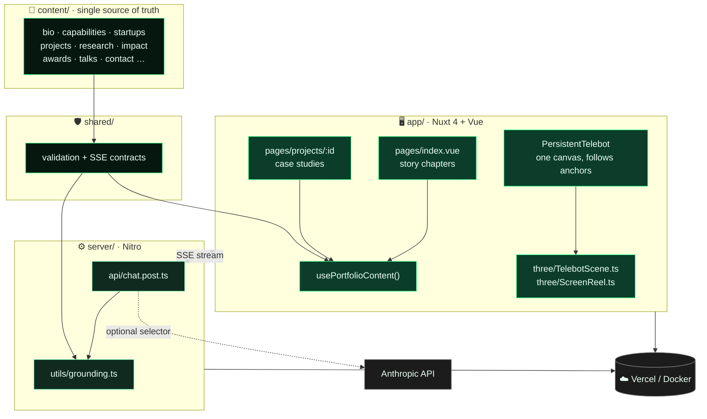
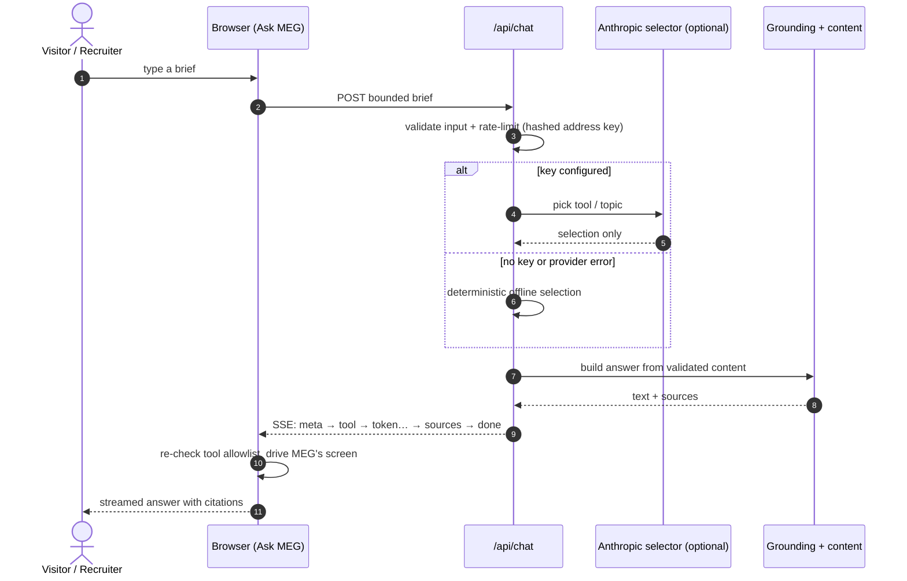
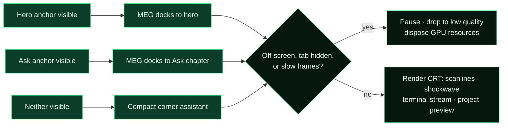

<div align="center">


<br/>


**An editorial story first, a 3D experience second.**
Identity, origin, capabilities, a venture case file, research, impact, work, people, **Ask MEG**, contact.

[](https://gitdiagram.com/shiv0xparanoid/Portfolio)
[](LICENSE)

[About](#-about) · [Workflow](#-workflow) · [Run It](#-run-it) · [Content](#-editing-content) · [MEG](#-meg) · [Deploy](#-deploy) · [Structure](#-project-map)

</div>

<br/>

## ✦ About

A personal portfolio of capabilities, awards and projects, built around **MEG**, a persistent CRT-TV assistant that follows you down the page.

- **Nuxt 4 + TypeScript.** The story stays SSR-friendly HTML and CSS, and Three.js is loaded dynamically, only for MEG's scene.
- **Content is JSON.** Edit files in `content/`, never touch Vue for a normal update.
- **Grounded AI.** MEG never writes facts. The model only *selects*, and answers are assembled from validated content with citations.
- **Works with zero keys.** No Anthropic key? `/api/chat` streams a deterministic offline answer.
- **Honest by design.** An unconfirmed fact stays `[PLACEHOLDER]` and is never rendered as a link.

<br/>

## ✦ Workflow

> 🔍 **Interactive version:** open this repo on **[GitDiagram](https://gitdiagram.com/shiv0xparanoid/Portfolio)** for the auto-generated, clickable architecture view. (Replace `github.com` with `gitdiagram.com` in any repo URL.) The diagrams below are the curated versions.

### 1 · System architecture



### 2 · Ask MEG: grounded answer flow



> The model never writes portfolio facts or citations. Tool names and arguments are allowlisted on the server **and** again in the browser.

### 3 · MEG's life cycle



<br/>

## ✦ Run It

> **Needs:** Node `20.19.5` (pinned in `.nvmrc`) and npm 10+.

```bash
npm ci
npm run dev          # http://localhost:3000
```

```bash
npm run typecheck
npm run test
npm run preview
make test            # offline verification: typecheck + production build, no API key needed
```

**Docker**

```bash
docker build -t shivang-portfolio .
docker run --rm -p 3000:3000 shivang-portfolio
```

<br/>

## ✦ Editing Content

Edit JSON only. Every file is validated on the server and at the client boundary.

| File | Owns |
|---|---|
| `content/bio.json` | Name, role, tagline, pitch, origin lines, timeline, research focus |
| `content/capabilities.json` | Numbered capabilities and the builds that prove each one |
| `content/startups.json` | Venture case files (real ventures only) |
| `content/projects.json` | `PRJCT/NN` records, decisions, outcomes, links, media |
| `content/research.json` | Published writing, kept separate from focus areas |
| `content/impact.json` | Owner-reported impact rows and source state |
| `content/testimonials.json` | Real quotes and the honesty note |
| `content/awards.json` · `press.json` · `talks.json` | Recognition and appearances |
| `content/music.json` | Discography and the public SoundCloud link |
| `content/contact.json` | Email, timezone, availability, social links |
| `content/media.json` | Confirmed photos and videos for the CRT reel |

> ⚠️ **Honesty rule:** a fact without an owner-confirmed source stays `[PLACEHOLDER]` or `owner-reported-awaiting-source`. Never put secrets, analytics exports or API keys in these files.

<br/>

## ✦ MEG

One canvas, procedurally built in Three.js, no model files.

- **Anchors:** follows `[data-telebot-anchor="hero"]` and `"ask"`, then shrinks to a corner assistant
- **Screen:** `ScreenReel.ts` runs the CRT channels, typed boot, terminal stream, scanlines, vignette, pointer ripple and project preview
- **Performance:** lazy-loaded, pauses off-screen and when the tab is hidden, disposes geometries, materials and textures, drops quality after slow frames
- **Accessibility:** honors reduced motion, and the Capabilities chapter falls back to a static grid
- **Contract:** `useTelebot()` exposes `setChannel`, `setMood`, `streamText`, `playMedia`, `setProjectPreview`, `dance`

<br/>

## ✦ Environment

Copy `.env.example` to `.env`, or set these in Vercel. Never commit `.env`.

| Variable | Scope | Purpose |
|---|---|---|
| `NUXT_ANT_THROPIC_KEY` | server-only | Optional Anthropic key, never sent to the browser |
| `NUXT_ANTHROPIC_MODEL` | server-only | Optional model name your account can use |
| `NUXT_PUBLIC_SITE_URL` | public | Final HTTPS origin for the sitemap and Person JSON-LD |

<br/>

## ✦ Deploy

1. Import this folder into Vercel as a Nuxt project
2. Set `NUXT_PUBLIC_SITE_URL` to the final HTTPS URL
3. Set `NUXT_ANT_THROPIC_KEY` only if you want live selector routing
4. Build with the default `npm run build`
5. Verify `/`, `/projects/holopad`, `/sitemap.xml`, `/robots.txt` and `/api/chat`

<br/>

## ✦ Project Map

```
app/pages/index.vue                 story order
app/pages/projects/[id].vue         deep-linkable case studies
app/components/PersistentTelebot    one-canvas placement shell
app/three/TelebotScene.ts           procedural 3D rig
app/three/ScreenReel.ts             shader + CRT screen module
content/                            editable canonical facts
shared/                             validation and SSE contracts
server/api/chat.post.ts             grounded AI boundary
server/utils/grounding.ts           deterministic answer + tool selection
tests/ · scripts/ · types/          checks, tooling, shared types
```

<br/>

<div align="center">

Built by **[Shivang](https://github.com/shiv0xparanoid)**

<sub>MIT licensed · say hi to MEG on the live site 📺</sub>


</div>
